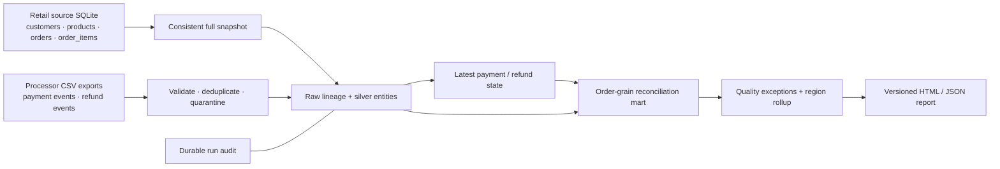

# Retail payment assurance · data engineering portfolio

A reproducible **multi-table, multi-source retail ETL project** with synthetic business data, executable validation, payment/refund state reconstruction, cross-source reconciliation and a generated reporting layer.

**Start here:** [architecture & model](docs/commerce/architecture.md) · [business contracts](docs/commerce/contracts.md) · [operating runbook](docs/commerce/runbook.md) · [interviewer walkthrough](docs/commerce/interviewer.md) · [example report](reports/commerce/demo.html) · [report JSON](reports/commerce/demo.json)

This is a local reference implementation, not a production deployment or accounting system. All customers, transactions and source systems are fictional. No real personal or company data is included.

## The business problem

An order can contain multiple items and be funded by multiple payments. A payment may change state after its first arrival, and partial refunds arrive independently. Joining every detail row together inflates totals; filtering successes before choosing the latest payment state retains voided payments. This project makes those errors testable and exposes order/payment discrepancies for investigation.



## Reproduce the full project

Requires **Python 3.9+ and SQLite 3.25+**. No packages, credentials, cloud account or paid service required. From the repository root:

```sh
python3 -m unittest discover -s tests -v
python3 -m commerce.run                   # generate fictional sources, ingest base batch
python3 -m commerce.run                   # replay: no duplicate business facts
python3 -m commerce.run --batch late      # late event, balance payment, correction, refund
python3 -m commerce.run --batch late      # replay delta, unchanged business results
```

Each run prints its report path under ignored `build/commerce/reports/run-N/report.html`. `latest.json` points to the last completely exported bundle. Open HTML locally; GitHub's file browser displays source, not a hosted dashboard.

| Verified synthetic scenario | Collectible orders | Current captures | Current successful refunds | Net payment snapshot |
|---|---:|---:|---:|---:|
| Base batch | CAD 290.00 | CAD 270.00 | CAD 10.00 | CAD 260.00 |
| After late batch | CAD 290.00 | CAD 290.00 | CAD 30.00 | CAD 260.00 |

Base has two expected order discrepancies: order 503 is under-captured by CAD 30; order 506 is over-captured by CAD 10. The late batch resolves both. Refunds **do not reduce original order value**. Net payment is **not accounting revenue, profit, or bank-settled cash**.

## Implemented capabilities

- **Six business entities**: customers, products, orders, order items, payments and refunds. Database snapshot extraction and CSV event ingestion are both executed.
- **Raw / silver / gold separation** with source content hashes, raw payloads, row lineage and per-run metrics.
- **Full master/order refresh** with an explicit source contract; immutable financial events with replay detection and conflict quarantine.
- **Late-arriving event handling**, deterministic ties and latest-state selection before business filtering.
- **Exact integer-cent calculations**, separate order/payment/refund aggregation, cancelled-order policy, zero payments and split payments.
- **Cross-source order/payment reconciliation**, refund-exposure alerts, conservation invariants, and actionable exceptions. This is not independent bank reconciliation.
- **Transactional batch writes**, durable failed-run audit, atomic publication of a pointer to matching HTML/JSON report bundles.
- **48 local tests** covering positive cases, negative controls, malformed data, orphan retry, source refresh, failure rollback, report consistency and both pipelines. GitHub Actions runs tests and replay scenarios; remote CI status must be checked for the specific commit.

## Repository map

| Path | Purpose |
|---|---|
| `commerce/fixtures.py` | Reproducible source DB, base and late event export generator |
| `commerce/run.py` | Extraction, validation, quarantine, audit, transform and report orchestration |
| `sql/commerce/marts.sql` | Latest-state views and order-grain reconciliation SQL |
| `tests/test_commerce.py` | Multi-source integration and failure-path tests |
| `data/commerce/` | Inspectable fictional CSV examples and generation contract |
| `reports/commerce/` | Generated base/late examples |
| `docs/commerce/` | Contracts, architecture, operations and interview walkthrough |
| `pipeline/`, `sql/0*.sql`, `sql/payment_snapshot.sql` | Original focused payment-snapshot module, retained as a smaller reference |

The earlier module remains runnable with `python3 -m pipeline.run`. Its dataset and totals are **different** from the retail project; see [its original scope](docs/architecture.md).

## Deliberate boundaries

SQLite batch execution only. No CDC, SCD2, streaming, FX, accounting revenue recognition, bank settlement feed, source API, access-control system or cloud deployment is claimed. Full snapshot extraction trades scalability for reproducibility. There is no performance benchmark. The original MySQL-style reference has not been end-to-end verified against a MySQL server. [Deployment considerations](docs/deployment.md) are planning material, not a deployed cloud environment.
