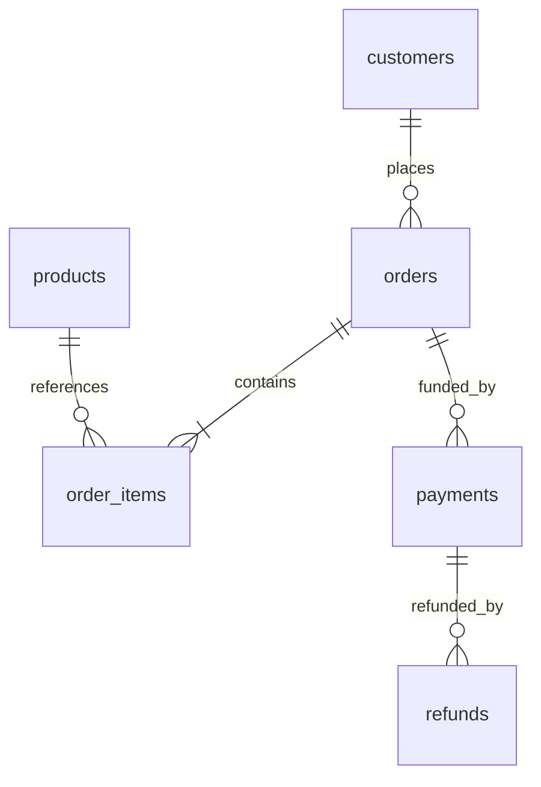

# Architecture and model

## Extract → load raw → transform → validate → publish

`commerce.run` generates its demonstration sources only when they do not exist. A source SQLite database contains four operational tables. A read-only connection and one read transaction extract a consistent full snapshot. Two processor CSVs supply incremental payment/refund events. A source schema mismatch or invalid relational snapshot fails the whole run, preserving the previous warehouse state.

The warehouse has ten physical tables and three analytical views:

| Layer | Object | Grain / purpose |
|---|---|---|
| Operations | `ops_runs` | One invocation, including failed attempts; manifests, status, metrics and persisted report |
| Raw | `raw_snapshots` | One source snapshot row per run/entity/row number |
| Raw | `raw_event_rows` | Every event CSV row in committed batches, including duplicates/rejections and reasons |
| Quality | `quality_issues` | One investigation item per run/type/entity |
| Silver | `silver_customers` | Current full snapshot, one customer |
| Silver | `silver_products` | Current full snapshot, one product |
| Silver | `silver_orders` | Current full snapshot, one order |
| Silver | `silver_order_items` | Current full snapshot, one order line |
| Silver | `silver_payment_events` | Immutable accepted payment event, keyed by event_id |
| Silver | `silver_refund_events` | Immutable accepted refund event, separate event_id namespace |
| Silver view | `silver_current_payments` | Latest accepted event per payment_id |
| Silver view | `silver_current_refunds` | Latest accepted event per refund_id |
| Gold view | `gold_order_reconciliation` | One order, including orders without payments |

Payments/refunds in this diagram are business identities reconstructed from accepted event histories, not one row per arrival. All dimensions and facts use fictional identifiers. No customer email or address is necessary for this use case.

## Transformation design

1. Validate full retail snapshot and references before replacing silver snapshots.
2. Preserve immutable event histories and raw committed batch evidence.
3. Accept exact replay as a duplicate; quarantine conflicting immutable event IDs or parent reassignment.
4. Select current payment/refund states by `(updated_at DESC, event_id DESC)`.
5. Aggregate order lines, captures and refunds separately before joining. This prevents many-to-many monetary fanout.
6. Check coverage and independent aggregate conservation. Persist a report snapshot within the same database transaction.
7. Export per-run HTML and JSON, then atomically replace `latest.json`. A failed export cannot advance the pointer; the committed report remains in `ops_runs` for recovery.

## Concurrency and history

Single scheduled writer is the operating contract. SQLite transactions serialize warehouse writes, but source runs do not have a business watermark, so overlapping full snapshots are not supported. Do not run overlapping orchestrators. Full snapshot replacements include updates and deletions; deletion of an order referenced by retained financial events fails explicitly instead of silently dropping payment value. No source CDC or SCD2 history is claimed. Raw snapshots and persisted per-run reports retain previous observations.

Source timestamps are UTC seconds. They represent authoritative event ordering in this synthetic contract, not processing time. The report is a current-state snapshot, not an as-of ledger or a daily cashflow report. The displayed order date must not be interpreted as payment/refund date.
